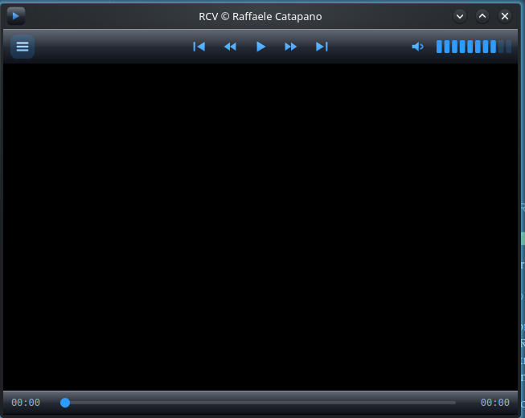

# RCVPlayer

[English](README.md) | **Italiano**




RCVPlayer è un ottimo lettore multimediale e autocontenuto per Linux. L'interfaccia
è bilingue (italiano / inglese): segue la lingua di sistema e si può cambiare dalla
finestra. La riproduzione audio può essere instradata in una catena DSP integrata
(equalizzatore, riverbero, spazializzazione 8D/4D, limitatore) scritta in puro NumPy.

## Caratteristiche
- Riproduce video (mp4, mkv, avi, mov, webm, wmv, flv, m4v, mpg, mpeg, ts, ogv) e
  audio (mp3, flac, ogg, opus, wav, m4a, aac, wma)
- Interfaccia minimale in stile vetro con controlli disegnati a mano
- Playlist in finestra separata, con drag & drop di file e cartelle
- Copertina e metadati del brano (titolo, artista, album)
- Schermo intero con controlli a scomparsa; sempre in primo piano
- Velocità di riproduzione da 0,5× a 2,0×
- Selezione traccia audio e traccia sottotitoli
- Modalità compatta per la riproduzione solo audio
- Effetti audio (solo musica): equalizzatore 10 bande, riverbero, spaziale 8D/4D, preamp, limitatore

## Effetti audio
La finestra effetti (tasto `E`) instrada l'audio decodificato in una catena DSP
scritta in puro NumPy, senza dipendenza da SciPy. Gli effetti si applicano solo
alla musica (niente video) e a velocità di riproduzione 1×.

- **Equalizzatore**: 10 bande peaking a 31, 62, 125, 250, 500, 1k, 2k, 4k, 8k, 16k Hz,
  con 12 preset — Flat, Rock, Pop, Jazz, Classical, Bass Boost, Treble Boost,
  Vocal, Electronic, Hip-Hop, Acoustic, Loudness — più preamp ±12 dB
- **Riverbero**: 6 preset a convoluzione — Room, Studio, Plate, Hall, Cathedral, Cave —
  con mix wet regolabile
- **Spaziale**: 8D slow, 8D, 8D fast e 4D — la sorgente ruota attorno alla testa
  con differenze interaurali di tempo e attenuazione da ombra della testa
- **Limitatore**: limitatore soft sull'uscita per evitare il clipping

## Installazione
Scarica l'AppImage dalla pagina [Releases](https://github.com/MrGodLink/RCVPlayer/releases),
rendila eseguibile e avviala:

```bash
chmod +x RCVPlayer-1.3-x86_64.AppImage
./RCVPlayer-1.3-x86_64.AppImage
```

L'AppImage è autocontenuta: comprende Python, PySide6, le librerie Qt e il backend
FFmpeg, quindi non servono pacchetti di sistema oltre a un'uscita audio funzionante
e una sessione X11/Wayland.

## Utilizzo
```bash
./RCVPlayer-1.3-x86_64.AppImage [file1 file2 ...]
```
Apri i file dal menu, trascina file o cartelle sulla finestra, oppure passali da
riga di comando. La finestra playlist (`L`) elenca i brani correnti.

### Scorciatoie da tastiera
| Tasto | Azione |
|-------|--------|
| `Space` | Play / pausa |
| `Left` / `Right` | Salta ±5 s (`Shift` per ±30 s) |
| `Up` / `Down` | Volume |
| `M` | Mute |
| `F` | Attiva/disattiva schermo intero |
| `Esc` | Esci dallo schermo intero |
| `N` / `P` | Brano successivo / precedente |
| `I` | Mostra/nascondi copertina |
| `L` | Mostra/nascondi playlist |
| `E` | Mostra/nascondi effetti audio |
| `Ctrl+O` | Apri file |
| `Ctrl+Shift+O` | Apri cartella |
| `Ctrl+Q` | Esci |

## Contenuto del repository
| File | Scopo |
|------|-------|
| `README.md` | Documentazione (inglese) |
| `README.it.md` | Documentazione (italiano) |
| `LICENSE` | Licenza di distribuzione binaria + nota LGPL per Qt/PySide6 |
| `requirements.txt` | Dipendenze runtime bundled nell'AppImage |

L'AppImage compilata è pubblicata in
[Releases](https://github.com/MrGodLink/RCVPlayer/releases). Il codice sorgente
è privato e non viene distribuito.

## Crediti
Creato da **Raffaele Catapano** - [github.com/MrGodLink](https://github.com/MrGodLink)

### Altri progetti dell'autore
- [Claude-Disciplined-Coding](https://github.com/MrGodLink/Claude-Disciplined-Coding) - skill per Claude che impone ragionamento prima del codice, modifiche minime e ipotesi esplicite
- [Claude-Token-Meter](https://github.com/MrGodLink/Claude-Token-Meter) - skill per Claude che mostra in cima a ogni risposta una barra colorata con i token di contesto rimasti
- [Claude-Token-Saver](https://github.com/MrGodLink/Claude-Token-Saver) - skill per Claude che riduce il consumo di token in chat
- [MIDI-Studio](https://github.com/MrGodLink/MIDI-Studio) - strumento musicale MIDI
- [OSINT-Tracker](https://github.com/MrGodLink/OSINT-Tracker) - strumento di open source intelligence (OSINT)
- [RcFux](https://github.com/MrGodLink/RcFux) - utility grafica (PySide6) per creare chiavette USB avviabili su Linux
- [CISO-Converter](https://github.com/MrGodLink/CISO-Converter) - tool desktop (PySide6) per convertire ISO in CSO e CSO in ISO

## Licenza
L'**AppImage RCVPlayer** è distribuita con una licenza proprietaria a uso binario:
puoi installarla e usarla gratuitamente, ma non puoi reverse-engineerare,
decompilare, modificare o ridistribuire il binario. Vedi [LICENSE](LICENSE) per i
termini completi. Il codice sorgente è privato.

L'AppImage comprende **PySide6**, le librerie **Qt**, il backend **FFmpeg** e
**NumPy**, rispettivamente rilasciati sotto GNU LGPL v3 (PySide6, Qt), GNU LGPL/GPL
(FFmpeg, in base alla configurazione di build) e licenza BSD-3-Clause (NumPy). Tali
componenti restano sotto le rispettive licenze; il loro codice sorgente è
disponibile dai progetti upstream. L'AppImage consente la sostituzione delle
librerie shared LGPL in essa contenute, in conformità con la LGPL.
