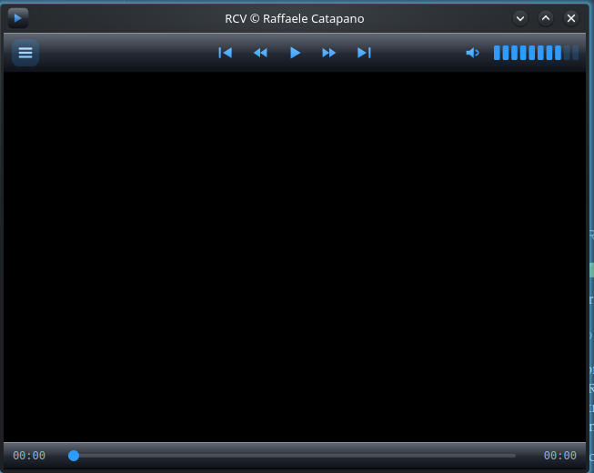

# RCVPlayer

**English** | [Italiano](README.it.md)




RCVPlayer is a great, self-contained media player for Linux. The interface is
bilingual (English / Italian): it follows your system language and can be switched
from the window. Audio playback can be routed through a built-in DSP chain
(equalizer, reverb, 8D/4D spatial, limiter) written in pure NumPy.

## Features
- Plays video (mp4, mkv, avi, mov, webm, wmv, flv, m4v, mpg, mpeg, ts, ogv) and
  audio (mp3, flac, ogg, opus, wav, m4a, aac, wma)
- Minimal glass-style interface with custom-painted controls
- Playlist in a separate window, with drag & drop of files and folders
- Cover art and track metadata (title, artist, album)
- Fullscreen with auto-hiding controls; always-on-top
- Playback speed from 0.5× to 2.0×
- Audio track and subtitle track selection
- Compact mode for audio-only playback
- Audio effects (music only): 10-band equalizer, reverb, 8D/4D spatial, preamp, limiter

## Audio effects
The effects window (press `E`) routes the decoded audio through a DSP chain
implemented in pure NumPy, with no SciPy dependency. Effects are applied to music
only (no video) and at 1× playback speed.

- **Equalizer**: 10 peaking bands at 31, 62, 125, 250, 500, 1k, 2k, 4k, 8k, 16k Hz,
  with 12 presets — Flat, Rock, Pop, Jazz, Classical, Bass Boost, Treble Boost,
  Vocal, Electronic, Hip-Hop, Acoustic, Loudness — plus a ±12 dB preamp
- **Reverb**: 6 convolution presets — Room, Studio, Plate, Hall, Cathedral, Cave —
  with adjustable wet mix
- **Spatial**: 8D slow, 8D, 8D fast and 4D — the source rotates around the head
  with interaural time differences and head-shadow attenuation
- **Limiter**: soft limiter on the output to prevent clipping

## Installation
Download the AppImage from the [Releases](https://github.com/MrGodLink/RCVPlayer/releases)
page, make it executable and run it:

```bash
chmod +x RCVPlayer-1.3-x86_64.AppImage
./RCVPlayer-1.3-x86_64.AppImage
```

The AppImage is self-contained: it bundles Python, PySide6, the Qt libraries and
the FFmpeg backend, so no system packages are required beyond a working audio
output and an X11/Wayland session.

## Usage
```bash
./RCVPlayer-1.3-x86_64.AppImage [file1 file2 ...]
```
Open files from the menu, drop files or folders onto the window, or pass them on
the command line. The playlist window (`L`) lists the current tracks.

### Keyboard shortcuts
| Key | Action |
|-----|--------|
| `Space` | Play / pause |
| `Left` / `Right` | Seek ±5 s (`Shift` for ±30 s) |
| `Up` / `Down` | Volume |
| `M` | Mute |
| `F` | Toggle fullscreen |
| `Esc` | Exit fullscreen |
| `N` / `P` | Next / previous track |
| `I` | Toggle cover art |
| `L` | Toggle playlist |
| `E` | Toggle audio effects |
| `Ctrl+O` | Open files |
| `Ctrl+Shift+O` | Open folder |
| `Ctrl+Q` | Quit |

## Repository contents
| File | Purpose |
|------|---------|
| `README.md` | This document (English) |
| `README.it.md` | Italian documentation |
| `LICENSE` | Binary distribution license + LGPL notice for bundled Qt/PySide6 |
| `requirements.txt` | Runtime dependencies bundled in the AppImage |

The compiled AppImage is published in
[Releases](https://github.com/MrGodLink/RCVPlayer/releases). The source code is
private and is not distributed.

## Credits
Created by **Raffaele Catapano** - [github.com/MrGodLink](https://github.com/MrGodLink)

### Other projects by the author
- [Claude-Disciplined-Coding](https://github.com/MrGodLink/Claude-Disciplined-Coding) - Claude skill that enforces think-before-coding, minimal diffs and explicit assumptions
- [Claude-Token-Meter](https://github.com/MrGodLink/Claude-Token-Meter) - Claude skill that shows a colored bar with the remaining context tokens at the top of every reply
- [Claude-Token-Saver](https://github.com/MrGodLink/Claude-Token-Saver) - Claude skill that reduces token consumption in chat
- [MIDI-Studio](https://github.com/MrGodLink/MIDI-Studio) - MIDI music tool
- [OSINT-Tracker](https://github.com/MrGodLink/OSINT-Tracker) - open source intelligence (OSINT) tool
- [RcFux](https://github.com/MrGodLink/RcFux) - graphical (PySide6) utility to create bootable USB drives on Linux
- [CISO-Converter](https://github.com/MrGodLink/CISO-Converter) - desktop tool (PySide6) to convert ISO to CSO and CSO to ISO

## License
The **RCVPlayer AppImage** is distributed under a proprietary binary license: you
may install and use it free of charge, but you may not reverse engineer,
decompile, modify or redistribute the binary. See [LICENSE](LICENSE) for the full
terms. The source code is private.

The AppImage bundles **PySide6**, the **Qt** libraries, the **FFmpeg** backend
and **NumPy**, which are respectively licensed under the GNU LGPL v3 (PySide6,
Qt), the GNU LGPL/GPL (FFmpeg, depending on build configuration) and the
BSD-3-Clause license (NumPy). Those components remain under their own licenses;
their source code is available from the upstream projects. The AppImage allows
the LGPL-licensed shared libraries inside it to be replaced, in compliance with
the LGPL.
